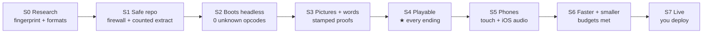
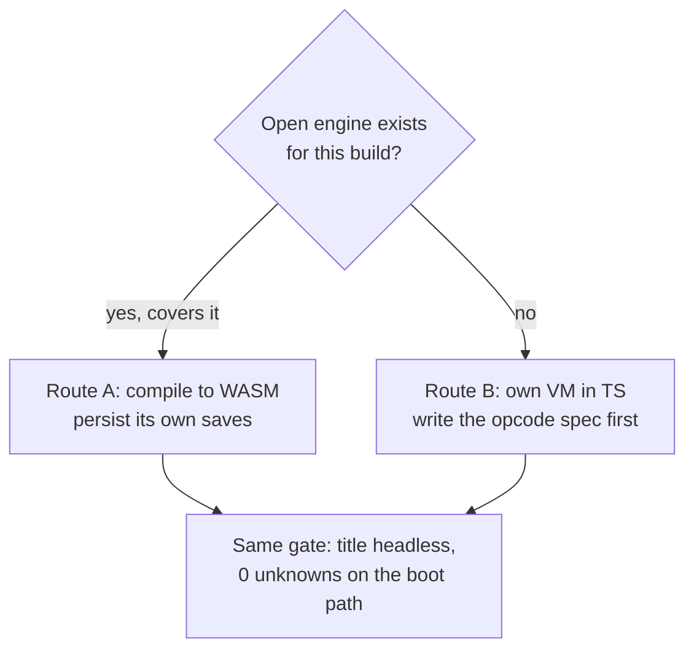

# VN Ports Workflow (private)

How we port visual novels to the browser — the shared method behind three ports (N2System, BGI, Artemis engines).

No game files live here. No scripts, art, voices, movies, exes, fonts, or story text. Only the workflow: stages, rules, ticket board, and file templates. You bring your own legally owned game.

## How a port flows



Playable (S4) is its own announced milestone — phones and polish come after, never before.

## Start here (10 minutes)

1. Read `AGENTS.md` (the work loop) and `knowledge/PLAYBOOK.md` (stages S0–S7).
2. Read `docs/PORTING-GUIDE.md` — pick your route: own VM (no open engine) or compile an open engine to WASM.
3. Scaffold a game repo: `npm run new-port -- <id> "<Full name>" "<engine>"`.
4. Work the tickets: `npm run issue -- goal`, `next`, `claim`, `done` (see `docs/CHECKLIST.md`).

## Which route? (pick once, in S0–S2)



Details: `docs/PORTING-GUIDE.md`. Licence check first — a GPL runtime compiled to WASM means publishing its source.

## What's inside

| Folder | What |
|---|---|
| `knowledge/` | Stages, evidence rules (`PROVEN / STRONG / LEAD`), firewall + proof patterns, engine notes, lessons |
| `board/` | Ticket CLI (`issue.mjs`), live board (`board.mjs`), search (`kb.mjs`), new-game scaffold (`new-port.mjs`) |
| `templates/` | Fresh-repo skeleton: firewall, proofs, PWA shell, mobile input, archive splitting, build/deploy |
| `docs/` | `PORTING-GUIDE.md` (route A vs B), `CHECKLIST.md` (per-ticket loop), `ENGINE-NOTES.md` (3 engines side by side) |
| `examples/` | Small sample ledger + decision entries so the format is clear |
| `scripts/` | `check-repo-clean.mjs` — proves no game content leaked |

```
vn-ports-workflow/
├── AGENTS.md            work loop + hard rules (agents read this first)
├── knowledge/           stages, evidence rules, lessons, engine notes
├── board/               tickets, live board, search, new-game scaffold
├── templates/           fresh-repo skeleton (copied per game)
├── docs/                porting guide, per-ticket checklist, engine notes
├── examples/            sample ledger + decision entries
└── scripts/             repo-clean checker (the gate)
```

## Rules that matter most

- Content firewall before the first commit. Game files live only in ignored folders.
- Never print story text — not in code, docs, tests, or commits. Use the masked viewer.
- Evidence over guesses. Two paths agree, or it stays a `LEAD`.
- Each ticket has a `Proof:` command. `done` runs it and refuses to close on failure.
- Commit locally only. You deploy, with `npm run deploy`, after a green smoke check.

See `knowledge/DEFAULTS.md` for the standing choices (playable first, phones second, polish last).
